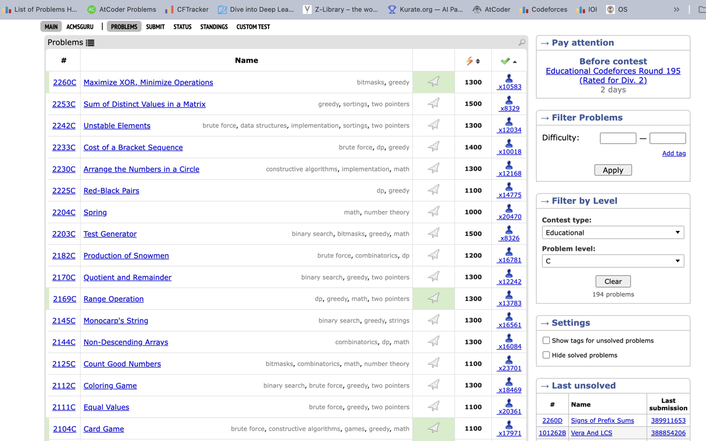

# CFLevels

A Chrome extension that adds **Contest Type** and **Problem Level** filters directly to the Codeforces problemset page.



---

## Why this exists

When practicing on `/problemset`, difficulty ratings alone do not tell the whole story. A 1600-rated problem today looks very different from a 1600-rated problem from an older round.

With the massive growth in active participation (from a few thousand contest entrants years ago to over 30,000 today) and shifting rating calibrations over the years, the contest meta has changed substantially and for a few other reasons as well (ykyk).

If you want to target realistic contest practice (like grinding current Div. 2 C problems to stop choking mid-contest, or drilling Div. 3 D and E), filtering purely by rating ends up mixing in decade-old rounds with completely different difficulty curves.

This project came directly out of my own frustration and personal need while practicing. I wanted a way to focus on contemporary Div. 2 C problems without manually hunting through past contests, so I built **CFLevels** to add a **→ Filter by Level** box right into the sidebar on `/problemset`.

---

## Features

- **Multi-select contest types**: Div. 1, Div. 2, Div. 3, Div. 4, Educational, Global, CodeTON, and others.
- **Multi-select problem levels**: Pick single or multiple letters (for example, practicing both `C` and `D` problems together).
- **Works with native filters**: Combine it directly with Codeforces tags (`dp`, `graphs`) and difficulty rating ranges (`1400-1600`).
- **Smart narrowing**: The level list automatically adjusts to show only letters that actually exist for your selected contest types and tags.
- **Preserves contest ordering**: Keeps problems sorted from newest to oldest by default, while still allowing you to use Codeforces' native reordering (by rating or solved count).
- **Native look**: Styled to match Codeforces' own roundbox borders and contest-page multi-select dropdowns.
- **Fast and private**: Runs entirely in your browser using public Codeforces API endpoints (`contest.list` and `problemset.problems`). No tracking, no external servers, no login required.

---

## Installation

### From Chrome Web Store
*(Pending review, link will be added once live)*

### Load Unpacked (Manual)

1. Clone or download this repository:
   ```bash
   git clone https://github.com/ShubhamPhapale/CFLevels.git
   ```
2. Open Google Chrome and go to `chrome://extensions`.
3. Turn on **Developer mode** in the top right.
4. Click **Load unpacked** in the top left.
5. Select the `CFLevels` folder.
6. Open [Codeforces Problemset](https://codeforces.com/problemset). The filter box will appear in the right sidebar below the native filter box.

---

## Author

**Shubham Phapale**  
GitHub: [@ShubhamPhapale](https://github.com/ShubhamPhapale)

---

## License

MIT
